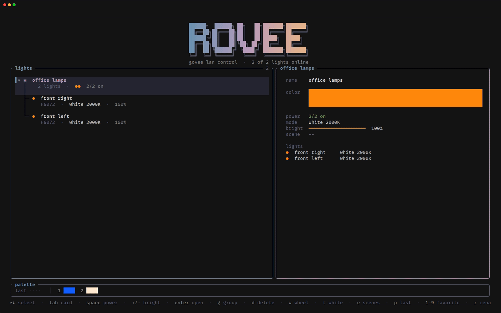

# rovee

A terminal app for controlling Govee lights over your local network, built with [Ratatui] and the [govee] crate.



## Features

- **No cloud.** Talks to your lights directly over Govee's LAN API.
- **Colors** select from a color wheel + save 9 favorites
- **Whites** from a warm-to-cool temperature slider (2000–9000K).
- **Brightness** and **power** for single lights or whole groups.
- **Scenes**: built-in presets (warm, focus, night, movie, bright) plus your own, saved from any light's current state.
- **Groups**: a collapsible tree of lights; anything you do to a group applies to every light in it.
- **Editable cards**: select a light or group and edit its name, color, white, brightness and scene right in the side panel.

## Requirements

- Govee lights with **LAN Control** turned on in the Govee Home app.
- The lights on the same network as your computer.
- UDP port **4002** open for incoming traffic from your network. On openSUSE with firewalld:

  ```sh
  sudo firewall-cmd --permanent --zone=public --add-rich-rule='rule family="ipv4" source address="192.168.1.0/24" port port="4002" protocol="udp" accept'
  sudo firewall-cmd --reload
  ```

  Replace `192.168.1.0/24` with your own network.

## Install

With [cargo-binstall] (downloads a prebuilt binary):

```sh
cargo binstall rovee
```

Or build from source with Cargo:

```sh
cargo install rovee
```

Prebuilt binaries and one-line installers for Linux, macOS and Windows are also on the [releases page](https://github.com/chip-davis/rovee/releases).

## Running

```sh
rovee
```

Or from a checkout of this repository:

```sh
cargo run --release
```

## Keys

**Lights list**

| Key | Action |
|---|---|
| `↑`/`↓`, `j`/`k` | Select |
| `Tab`, `Enter` on a light | Go into the card |
| `Enter`, `←`/`→` on a group | Fold / unfold |
| `space` | Power on / off |
| `+` / `-` | Brightness up / down |
| `w` | Color wheel |
| `t` | White temperature slider |
| `c` | Scenes |
| `p` | Apply the last color again |
| `1`–`9` | Apply a favorite |
| `g` | Add the light to a group, or create one |
| `d` | Delete the selected group |
| `r` | Rename |
| `s`, `F5` | Rescan the network |
| `q` | Quit |

**Card**

| Key | Action |
|---|---|
| `↑`/`↓` | Move between fields |
| `Enter` | Edit the name, open the wheel, toggle power, open the white slider, or open scenes |
| `←`/`→` on brightness | Adjust |
| `Tab`, `Esc` | Back to the list |

In the color wheel, click to set a color and press `f` to save it as a favorite.

## Configuration

Device names, groups, favorites and your own scenes are saved to `~/.config/rovee/devices.toml`. The file is plain TOML, so you can also edit it by hand.

## License

Copyright (c) chip

This project is licensed under the MIT license ([LICENSE] or <http://opensource.org/licenses/MIT>)

[Ratatui]: https://ratatui.rs
[govee]: https://crates.io/crates/govee
[VHS]: https://github.com/charmbracelet/vhs
[cargo-binstall]: https://github.com/cargo-bins/cargo-binstall
[LICENSE]: ./LICENSE
